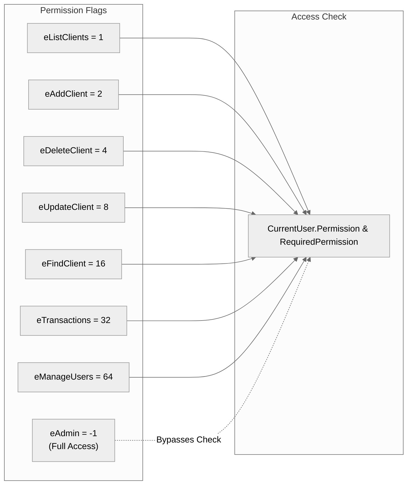
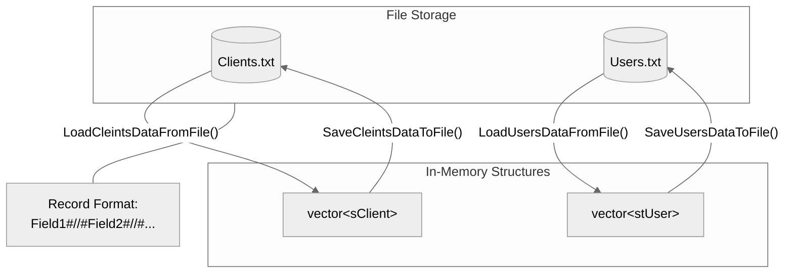

# Bank Management System - Architecture Analysis

## System Sequence Diagram

```mermaid
%%{init: {'theme': 'neutral', 'themeVariables': { 'primaryColor': '#f4f4f4', 'primaryTextColor': '#333', 'primaryBorderColor': '#666', 'lineColor': '#666', 'secondaryColor': '#e8e8e8', 'tertiaryColor': '#fff'}}}%%

sequenceDiagram
    autonumber
    participant U as User
    participant App as Application
    participant Auth as Authentication
    participant MM as Main Menu
    participant TM as Transactions Menu
    participant UM as User Management
    participant FS as File System

    Note over U,FS: Application Startup & Login Flow

    U->>App: Launch Application
    App->>Auth: ShowLoginScreen()
    Auth->>FS: LoadUsersDataFromFile()
    FS-->>Auth: vector<stUser>
    Auth->>U: Request Username/Password
    U->>Auth: Enter Credentials

    alt Invalid Credentials
        Auth-->>U: "Invalid Username/Password"
        Auth->>U: Request Credentials Again
    else Valid Credentials
        Auth->>App: Set CurrentUser
        Auth->>MM: ShowMainMenue()
    end

    Note over MM: Main Menu Options [1-8]

    rect rgb(240, 248, 255)
        Note right of MM: Client Operations
        U->>MM: Select Option [1-5]
        MM->>MM: CheckAccessRights(Permission)

        alt Access Denied
            MM-->>U: ShowAccessDeniedMessage()
        else Access Granted
            alt [1] List Clients
                MM->>FS: LoadCleintsDataFromFile()
                FS-->>MM: vector<sClient>
                MM-->>U: Display Client List
            else [2] Add Client
                MM->>U: ReadNewClient()
                U->>MM: Client Details
                MM->>FS: AddDataLineToFile()
            else [3] Delete Client
                MM->>FS: LoadCleintsDataFromFile()
                MM->>U: Confirm Deletion
                MM->>FS: SaveCleintsDataToFile()
            else [4] Update Client
                MM->>FS: LoadCleintsDataFromFile()
                MM->>U: Enter New Details
                MM->>FS: SaveCleintsDataToFile()
            else [5] Find Client
                MM->>FS: LoadCleintsDataFromFile()
                MM-->>U: PrintClientCard()
            end
        end
    end

    rect rgb(255, 248, 240)
        Note right of TM: Transaction Operations [6]
        U->>MM: Select [6] Transactions
        MM->>MM: CheckAccessRights()
        MM->>TM: ShowTransactionsMenue()

        alt [1] Deposit
            TM->>FS: LoadCleintsDataFromFile()
            TM->>U: Enter Amount
            TM->>TM: DepositBalanceToClient()
            TM->>FS: SaveCleintsDataToFile()
        else [2] Withdraw
            TM->>FS: LoadCleintsDataFromFile()
            TM->>U: Enter Amount
            Note over TM: Validate: Amount <= Balance
            TM->>TM: DepositBalanceToClient(Amount * -1)
            TM->>FS: SaveCleintsDataToFile()
        else [3] Total Balances
            TM->>FS: LoadCleintsDataFromFile()
            TM-->>U: Display All Balances + Total
        else [4] Return
            TM->>MM: ShowMainMenue()
        end
    end

    rect rgb(248, 255, 240)
        Note right of UM: User Management [7]
        U->>MM: Select [7] Manage Users
        MM->>MM: CheckAccessRights(eManageUsersPermission)
        MM->>UM: ShowManageUsersMenue()

        alt [1] List Users
            UM->>FS: LoadUsersDataFromFile()
            UM-->>U: Display User List
        else [2] Add User
            UM->>U: ReadNewUser() + Permissions
            UM->>FS: AddDataLineToFile()
        else [3] Delete User
            Note over UM: Cannot delete "Admin"
            UM->>FS: SaveUsersDataToFile()
        else [4] Update User
            UM->>U: EditUserRecord()
            UM->>FS: SaveUsersDataToFile()
        else [5] Find User
            UM->>FS: LoadUsersDataFromFile()
            UM-->>U: PrintUserCard()
        end
    end

    Note over U,FS: Logout Flow
    U->>MM: Select [8] Logout
    MM->>Auth: ShowLoginScreen()
    Note over App: Loop continues indefinitely
```



---

## Key Architectural Observations

| Component             | Responsibility                                                     |
| --------------------- | ------------------------------------------------------------------ |
| **Authentication**    | User login validation, session management via `CurrentUser` global |
| **Main Menu**         | Central navigation hub with permission-based routing               |
| **Transactions Menu** | Deposit/Withdraw operations with balance validation                |
| **User Management**   | CRUD for system users with permission assignment                   |
| **File System**       | Persistent storage using delimited text files (`#//#`)             |

---

## Permission System (Bitwise Flags)



---

## Data Flow Summary



---

## Data Structures

### sClient Structure

```cpp
struct sClient {
    string AccountNumber;
    string PinCode;
    string Name;
    string Phone;
    double AccountBalance;
    bool MarkForDelete = false;
};
```

### stUser Structure

```cpp
struct stUser {
    string UserName;
    string Password;
    int Permition;
    bool MarkForDelete = false;
};
```

---

## File Format

Both `Clients.txt` and `Users.txt` use `#//#` as the field delimiter.

**Clients.txt Example:**

```
ACC001#//#1234#//#John Doe#//#555-1234#//#5000.00
```

**Users.txt Example:**

```
Admin#//#admin123#//#-1#//#
```
